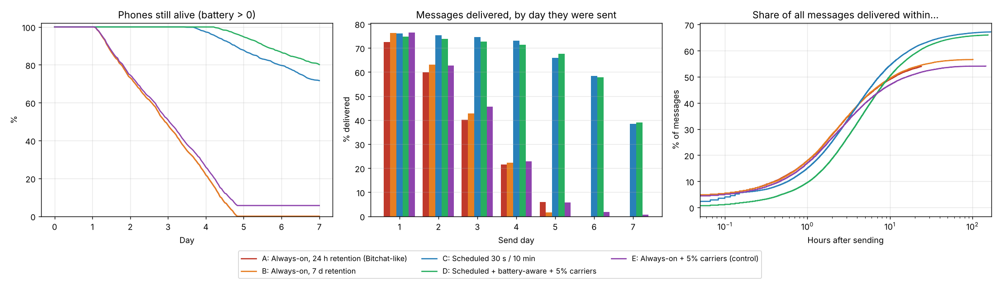
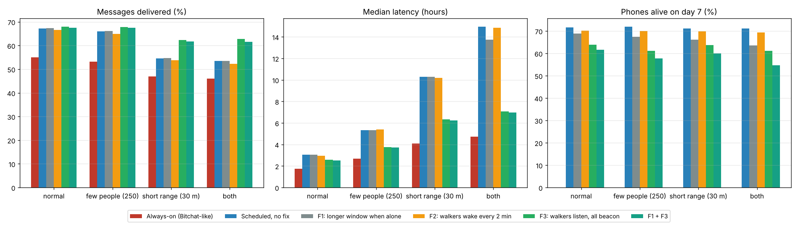

# QC Crisis-Mesh Simulation

Compares **always-on** phone mesh (how current apps such as Bitchat work) with QC's **scheduled-rendezvous** design (see [`docs/DESIGN.md`](../docs/DESIGN.md)) in a 7-day collapse: no grid, no cell network, no internet.

```bash
pip install numpy scipy matplotlib
python -m sim.run            # full run: 7 days, 3 seeds, all scenarios + sensitivity (~5 min on 4 cores)
python -m sim.run --quick    # 2-day smoke run
```

Outputs go to [`sim/results/`](results/): `results.md`, `summary.json`, `comparison.png`.



## Scenarios

| | Radio | Retention | Extras |
|---|---|---|---|
| **A** | Always on | 24 h | — (Bitchat-like) |
| **B** | Always on | 7 days | — |
| **C** | 30 s every 10 min, all phones together | 7 days | — |
| **D** | Like C, but battery-aware (10 → 30 → 60 min as battery drops) | 7 days | 5% carrier phones with a power source |
| **E** | Always on | 7 days | 5% carriers (control for D) |

## Results (mean of 3 seeds)

| Scenario | Delivered | ≤1 h | ≤6 h | Median latency | Alive day 3 | Alive day 7 |
|---|---|---|---|---|---|---|
| A: Always-on, 24 h | 54% | 18% | 44% | 113 min | 48% | 0% |
| B: Always-on, 7 d | 57% | 18% | 44% | 121 min | 48% | 0% |
| **C: Scheduled 10 min** | **67%** | 15% | 46% | 185 min | **100%** | **72%** |
| **D: Scheduled + battery-aware + carriers** | **66%** | 10% | 41% | 248 min | **100%** | **80%** |
| E: Always-on + carriers | 54% | 17% | 42% | 123 min | 51% | 6% |

Messages delivered, by the day they were sent:

| | Day 1 | Day 2 | Day 3 | Day 4 | Day 5 | Day 6 | Day 7 |
|---|---|---|---|---|---|---|---|
| A | 72% | 60% | 40% | 21% | 6% | — | — |
| C | 76% | 75% | 74% | 73% | 66% | 58%* | 39%* |
| D | 75% | 74% | 73% | 71% | 68% | 58%* | 39%* |

\* Partly a simulation-end effect: messages sent late have less time left to be delivered before day 7 ends.

### What this shows

1. **Always-on phones die by day 5.** Half are dead by day 3; messages sent on day 4 or later almost never arrive. Longer retention (B) or carriers (E) do not fix this — the phones that would carry the messages are dead.
2. **Scheduled rendezvous keeps the network alive for the whole week** and keeps delivery at ~73% through day 4, giving **more delivered messages overall (67% vs 54%)**.
3. **The price is latency.** On day 1, always-on is faster (18% vs 15% within 1 hour; median ~2 h vs ~3 h). Scheduled mode trades speed for survival.
4. **Battery-aware schedule and carriers add little in this model.** D keeps more phones alive on day 7 (80% vs 72%) but is slower than C. The main gain comes from the synchronized windows themselves. The battery thresholds need tuning.

### Sensitivity

| Variation | A delivered | D delivered | A alive day 3 | D alive day 3 | D median latency |
|---|---|---|---|---|---|
| Radio power 50 mW (default 100) | 56% | 66% | 77% | 100% | 245 min |
| Radio power 200 mW | 52% | 66% | 0% | 100% | 256 min |
| 250 people (default 500) | 53% | 63% | 46% | 100% | 430 min |
| 1000 people | 58% | 70% | 48% | 100% | 175 min |
| BLE range 30 m (default 50) | 45% | 50% | 48% | 100% | 802 min |

The scheduled design delivers more in every variation. Its weak spot is **sparse networks** (fewer people, shorter range): latency grows to many hours, because short windows give walkers fewer chances to meet. Possible fixes to explore: longer windows when no neighbours are seen, or more frequent windows for phones that are moving.

## Sparse networks: which fix works?

```bash
python -m sim.sparse     # 4 settings × 6 variants × 3 seeds, 30 s tick (~10 min)
```



Variants on top of the scheduled design (30 s every 10 min):

- **F1:** a phone that saw nobody in its last window opens a 90 s window next time.
- **F2:** walking phones also wake every 2 minutes.
- **F3: "walkers listen, everyone whispers."** Every phone emits a cheap, low-rate connectable Bluetooth beacon (assumed 3 mW). A phone that is walking (accelerometer) keeps scanning while it moves, and exchanges messages with any phone it passes, even one that is asleep.

Hardest setting (250 people, 30 m range); full tables in [`results/sparse.md`](results/sparse.md):

| Variant | Delivered | ≤6 h | Median latency | Alive day 7 | Radio energy (Wh/phone/day) |
|---|---|---|---|---|---|
| Always-on (Bitchat-like) | 46% | 27% | 4.7 h | 0% | 0.98 |
| Scheduled, no fix | 53% | 12% | 15.0 h | 71% | 0.15 |
| F1: longer window when alone | 53% | 12% | 13.8 h | 64% | 0.26 |
| F2: walkers wake every 2 min | 52% | 11% | 14.9 h | 69% | 0.17 |
| **F3: walkers listen, all beacon** | **63%** | **28%** | **7.1 h** | 61% | 0.28 |
| F1 + F3 | 62% | 28% | 7.0 h | 55% | 0.37 |

### What this shows

1. **F1 and F2 do not help.** Everyone else is asleep outside the shared windows, so waking more on one side alone finds nobody.
2. **F3 works.** In the sparse setting it halves median latency (15 h → 7 h), raises delivery from 53% to 63%, and matches always-on for delivery within 6 hours (28% vs 27%) — while using ~3.5× less radio energy than always-on and keeping 61% of phones alive on day 7 (always-on: 0%).
3. **Why it works:** contacts between people who stay put do not change, so a 10-minute rendezvous is enough for them. Contacts change only because people move, so the moving phone pays for discovering them.
4. **Cost:** more phones die by day 7 than with plain scheduling (61% vs 71%), mostly walkers who scan while moving. In dense, normal settings F3 gives only a small gain (median 3.1 h → 2.6 h).
5. **Assumption to verify:** that a phone can keep a low-rate connectable beacon running for ~3 mW and be reached by a passing scanner while its app is asleep. This needs real-phone measurements.

## Model and assumptions

All values are fields of `Config` in [`qcsim.py`](qcsim.py).

- **World:** 500 phones on 2 × 2 km. 70% near 15 gathering points (σ 60 m), 30% scattered. 25% walk between gathering points at 1 m/s, pausing 30–120 min.
- **Radio:** Bluetooth range 50 m, unit-disk model. Awake phones in range form a cluster; a message crosses a whole cluster in one tick (multi-hop mesh).
- **Store-and-forward:** Up to 8 copies per message (sender + carriers), 300 carried messages per phone. A copy holder meeting the recipient delivers it; acknowledgements clear all copies instantly (idealized).
- **Energy (assumed, not measured):** 17 Wh battery, initial charge 20–90%. Idle 20 mW (airplane mode + Bluetooth on), mesh radio + CPU 100 mW extra while on, 0.5 J per wake-up, 15 min/day of screen use at 1.2 W.
- **Clocks:** Drift 2 s/day (1σ). 30% of phones get a GPS time fix at wake-up; phones re-sync when they meet. Each phone widens its window by a guard time of 1 s + 3σ × time since last sync, and pays the energy for it.
- **Traffic:** Each living phone sends 6 messages/day to a random other person (the hardest case: recipient anywhere in the area).

### Limitations

- No radio collisions, bandwidth limits or packet loss; contacts are binary.
- Energy figures are estimates. **They must be measured on real phones** before making public claims.
- Mobility is a simple random-waypoint model.
- Clock guard assumes drift stays within 3σ.
- iOS background restrictions and Android vendor battery killers are not modelled.
